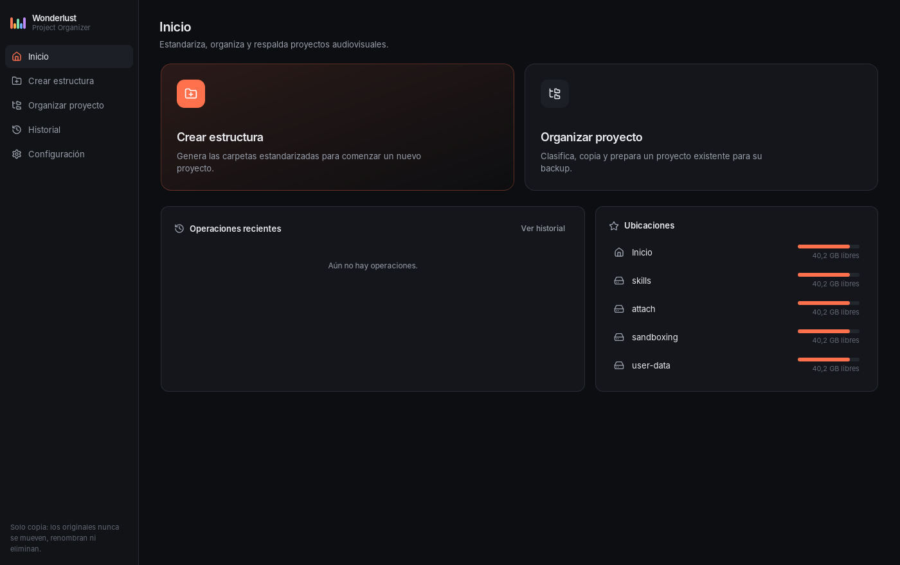
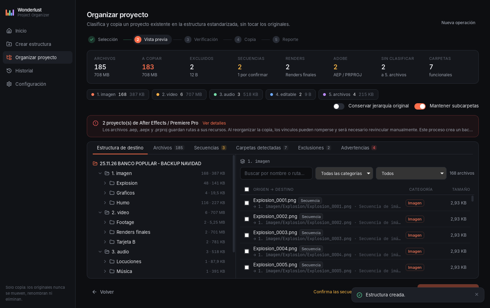
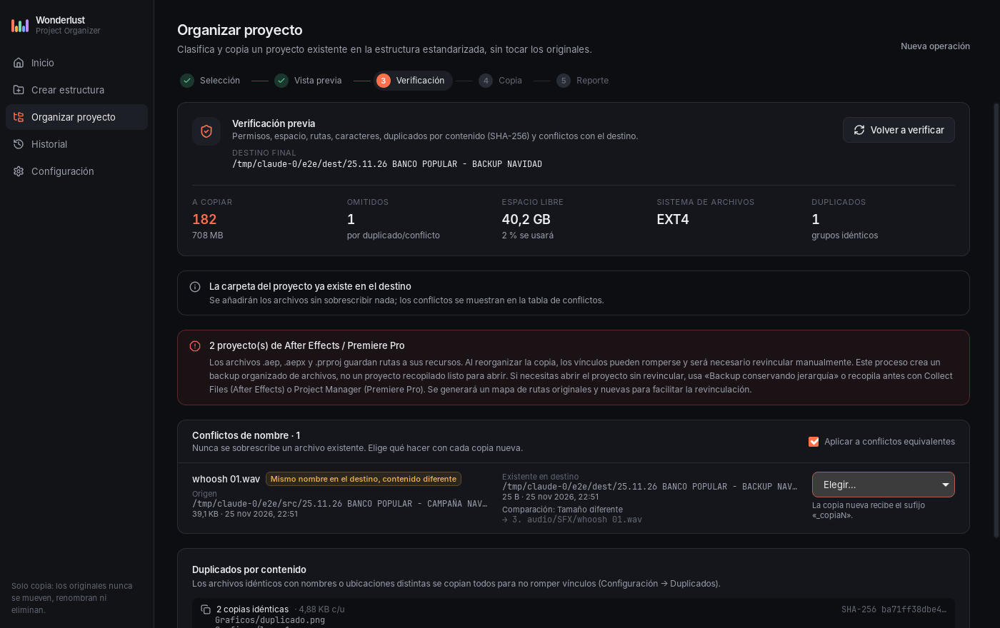
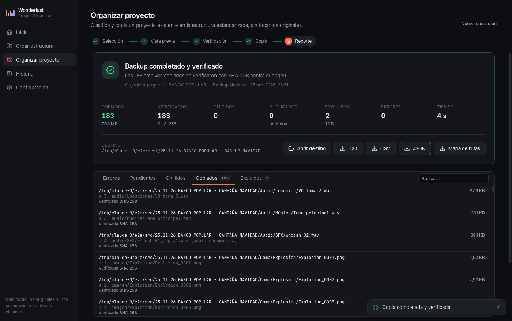

# Wonderlust Project Organizer

Aplicación de escritorio (Windows y macOS) para que el equipo de Wonderlust **cree estructuras
de proyecto estandarizadas**, **organice archivos automáticamente** y **prepare backups
verificados** de proyectos audiovisuales.

```
25.11.26 BANCO POPULAR - CAMPAÑA NAVIDAD/
├── 1. imagen/
├── 2. video/
├── 3. audio/
├── 4. editable/      ← exclusivo de .aep, .aepx y .prproj
└── 5. archivos/
```

| | |
|---|---|
|  |  |
|  |  |

**Regla de oro:** la aplicación solo copia. Los originales nunca se mueven, renombran,
modifican, sobrescriben ni eliminan.

---

## Funcionalidades

| Área | Qué hace |
|---|---|
| **Crear estructura** | Fecha (hoy por defecto), cliente, proyecto y destino → carpeta `DD.MM.AA CLIENTE - PROYECTO` con las cinco subcarpetas. Vista previa en vivo, completar carpetas faltantes sin tocar lo existente, abrir en Finder/Explorador. |
| **Organizar proyecto** | Arrastrar y soltar o seleccionar archivos/carpetas, análisis recursivo, clasificación por extensión (sin distinguir mayúsculas), vista previa navegable, cambios manuales, verificación previa y copia segura. |
| **Secuencias de imágenes** | Detecta prefijo, numeración, relleno, extensión, cantidad, carpeta y fotogramas faltantes. Cada secuencia va a su subcarpeta en `1. imagen/` conservando el nombre de su carpeta si ya la tenía. Las fotos de cámara (`IMG_0001.JPG`…) y grupos cortos se marcan como **ambiguos** y requieren confirmación. Nunca se renombran fotogramas. |
| **Subcarpetas funcionales** | Tarjetas de cámara (DCIM, PRIVATE/M4ROOT, XDROOT, CONTENTS, AVCHD, BPAV, `.RDM`/`.RDC`) se conservan completas; proxies, renders, música, SFX, locuciones, stock, recursos gráficos, autosaves, cachés y proyectos ya organizados se detectan con reglas locales (sin IA externa). Cada grupo se puede desactivar. |
| **Renders finales** | Sugerencia por palabras completas (FINAL, EXPORT, RENDER, MASTER, DELIVERY, APROBADO, ENTREGABLES…) en carpetas y archivos → `2. video/Renders finales/`. Se puede marcar o desmarcar cualquier video. La carpeta solo se crea si hay renders (configurable). |
| **Duplicados** | Mismo nombre con contenido distinto y contenido idéntico con nombres distintos. Filtro por tamaño → hash parcial → SHA-256. Opciones: omitir, conservar ambos (`_copiaN`), renombrar solo la copia, aplicar a conflictos equivalentes. |
| **Exclusiones** | Autosaves de AE/PR, Media Cache, cachés de AE, previews de render, proxies, temporales, ocultos, sistema, carpetas vacías, extensiones y carpetas personalizadas. Muestra cantidad y peso antes de copiar. Solo afectan a la copia. |
| **Verificación previa** | Permisos de lectura/escritura, espacio libre (con margen), existencia de rutas, conflictos, archivos inaccesibles, rutas > 260 caracteres, caracteres incompatibles con Windows, FAT32 y archivos ≥ 4 GB, destino dentro del origen (copia recursiva). |
| **Copia segura** | Streaming con búfer configurable, en segundo plano, operaciones simultáneas configurables, temporal `.wlpart` → `fsync` → verificación SHA-256 por relectura → fecha original → renombrado **sin sobrescritura** atómico. Pausa, cancelación segura, reintentos, detención limpia sin espacio. |
| **Recuperación** | Diario JSONL por operación. Tras un cierre inesperado, la operación aparece en Inicio y se reanuda sin repetir archivos ya verificados. |
| **Reporte** | Copiados, omitidos, excluidos, duplicados, errores, pendientes, tamaño, tiempo, destino e integridad. Exporta CSV, JSON, TXT y **mapa de rutas** original → nueva. Reintentar solo fallidos. Nunca declara éxito si hay pendientes o errores. |
| **Adobe** | Detecta AEP/AEPX/PRPROJ, advierte de vínculos rotos al reorganizar, ofrece *Backup conservando jerarquía*, recomienda *Collect Files* / *Project Manager*, genera el mapa de rutas y diferencia backup organizado de proyecto recopilado. No promete revinculación automática. |
| **Historial** | Fecha, cliente, proyecto, tipo, destino, archivos, tamaño, estado y reporte. Eliminar registros nunca elimina archivos de proyectos. |
| **Configuración** | Reglas de clasificación, exclusiones, secuencias, patrones de renders, duplicados, rutas frecuentes, nomenclatura, integridad, rendimiento, tema oscuro/claro. Guardado local. |

Detalles técnicos y decisiones: [`docs/ARQUITECTURA.md`](docs/ARQUITECTURA.md).
Guía de uso para el equipo: [`docs/MANUAL.md`](docs/MANUAL.md).

## Estado por fases

| Fase | Estado |
|---|---|
| 1. Base (arquitectura, UI, navegación, crear estructura, configuración) | ✅ Implementada y probada |
| 2. Organización local (escaneo, clasificación, vista previa, secuencias, copia segura) | ✅ Implementada y probada |
| 3. Avanzado (duplicados, exclusiones, renders, validación, historial, reportes, reanudación) | ✅ Implementada y probada |
| 4. Google Drive (API) | ⏳ **Pendiente.** Requiere un ID de cliente OAuth de Wonderlust en Google Cloud. Hoy funciona con **Google Drive para escritorio** como destino local (se detecta automáticamente). |
| 5. Distribución | ✅ Workflow de CI para `.exe`/`.msi` (Windows) y `.app`/`.dmg` (macOS). Sin firma de código hasta configurar certificados. |

## Descargar / instalar

Los instaladores se generan con GitHub Actions (`.github/workflows/build.yml`) en cada push a
`main` o al crear una etiqueta `v*`: pestaña **Actions** → ejecución → **Artifacts**.

* **Windows:** `Wonderlust Project Organizer_0.1.0_x64-setup.exe` (instalador NSIS, no requiere
  administrador) o `.msi`. Usa WebView2, incluido en Windows 10/11.
* **Linux:** `.deb` y `.AppImage` (útil para pruebas internas).
* **macOS (Apple Silicon e Intel):** `.dmg` universal. Mientras la app no esté firmada y
  notarizada, la primera vez: clic derecho sobre la app → **Abrir**.

El usuario final no necesita Node.js, Rust ni Python.

## Compilar desde el código

Requisitos: [Rust](https://rustup.rs) estable, Node.js 20+ y, según el sistema:

* **macOS:** Xcode Command Line Tools (`xcode-select --install`).
* **Windows:** Microsoft C++ Build Tools y WebView2 (ya incluido en Windows 10/11).
* **Linux (desarrollo):** `libwebkit2gtk-4.1-dev libgtk-3-dev librsvg2-dev libayatana-appindicator3-dev`.

```bash
npm install
```

```bash
npm run tauri dev
```

Instalador para el sistema actual (`src-tauri/target/release/bundle/`):

```bash
npm run tauri build
```

macOS universal (Intel + Apple Silicon):

```bash
rustup target add aarch64-apple-darwin x86_64-apple-darwin
```

```bash
npm run tauri build -- --target universal-apple-darwin
```

Instalador de Windows compilado desde Linux (experimental, requiere `nsis`, `lld`, `llvm`, `clang` y `cargo install cargo-xwin`):

```bash
npm run tauri build -- --runner cargo-xwin --target x86_64-pc-windows-msvc --bundles nsis
```

### Firma de código

Para evitar avisos de Gatekeeper/SmartScreen configura en el repositorio los secretos
`APPLE_CERTIFICATE`, `APPLE_CERTIFICATE_PASSWORD`, `APPLE_SIGNING_IDENTITY`, `APPLE_ID`,
`APPLE_PASSWORD` y `APPLE_TEAM_ID` (macOS). Para Windows, añade un certificado Authenticode
según la [guía de Tauri](https://v2.tauri.app/distribute/sign/windows/).

## Pruebas

| Comando | Cubre |
|---|---|
| `npm run test:core` | 81 pruebas unitarias y 11 de integración del núcleo en Rust (clasificación, mayúsculas, extensiones desconocidas, secuencias completas e incompletas, conflictos, duplicados, archivos grandes, cancelación, interrupciones, reanudación, permisos, espacio, nombres con tildes y caracteres especiales, destino dentro del origen, conservación de originales). |
| `npm test` | Utilidades del frontend (Vitest). |
| `npm run typecheck` | Tipos TypeScript. |
| `tests/e2e` | Pruebas de extremo a extremo de la aplicación compilada con WebDriver (Linux). Ver [`tests/e2e/README.md`](tests/e2e/README.md). |

La prueba de disco lleno se ejecuta si se define `WPO_SMALL_FS_DIR` apuntando a un sistema de
archivos pequeño (por ejemplo, un tmpfs de 2 MB). Las pruebas de permisos se ejecutan con un
usuario sin privilegios (como root se omiten). Todas usan directorios temporales: nunca tocan
archivos reales.

## Estructura del repositorio

```
src/                  Interfaz React + TypeScript + Tailwind
  lib/                API tipada, tipos, formato, estado
  components/         Componentes reutilizables
  pages/              Inicio, Crear estructura, Organizar (asistente), Historial, Configuración
src-tauri/
  src/                Comandos Tauri, trabajos en segundo plano, ubicaciones
  core/               Crate wpo-core: toda la lógica de archivos (sin dependencias de Tauri)
    tests/            Pruebas de integración
tests/e2e/            Pruebas de extremo a extremo (WebDriver)
docs/                 Arquitectura y manual de usuario
```

## Dónde guarda datos la aplicación

| Sistema | Configuración | Historial, trabajos y reportes |
|---|---|---|
| macOS | `~/Library/Application Support/com.wonderlust.projectorganizer/` | mismo directorio |
| Windows | `%APPDATA%\com.wonderlust.projectorganizer\` | `%APPDATA%\com.wonderlust.projectorganizer\` |
| Linux | `~/.config/com.wonderlust.projectorganizer/` | `~/.local/share/com.wonderlust.projectorganizer/` |

Además, si está activado, cada backup guarda un reporte TXT y el mapa de rutas en
`5. archivos/_Reporte Wonderlust/` (o en la raíz del destino en backups con jerarquía).
